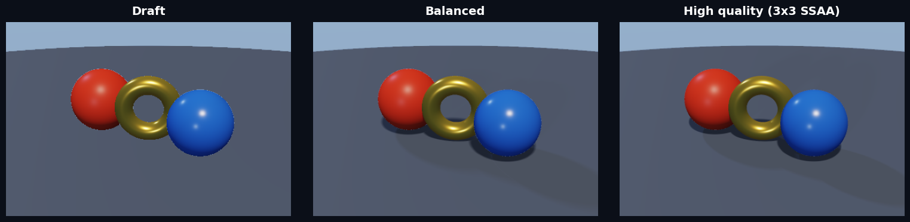
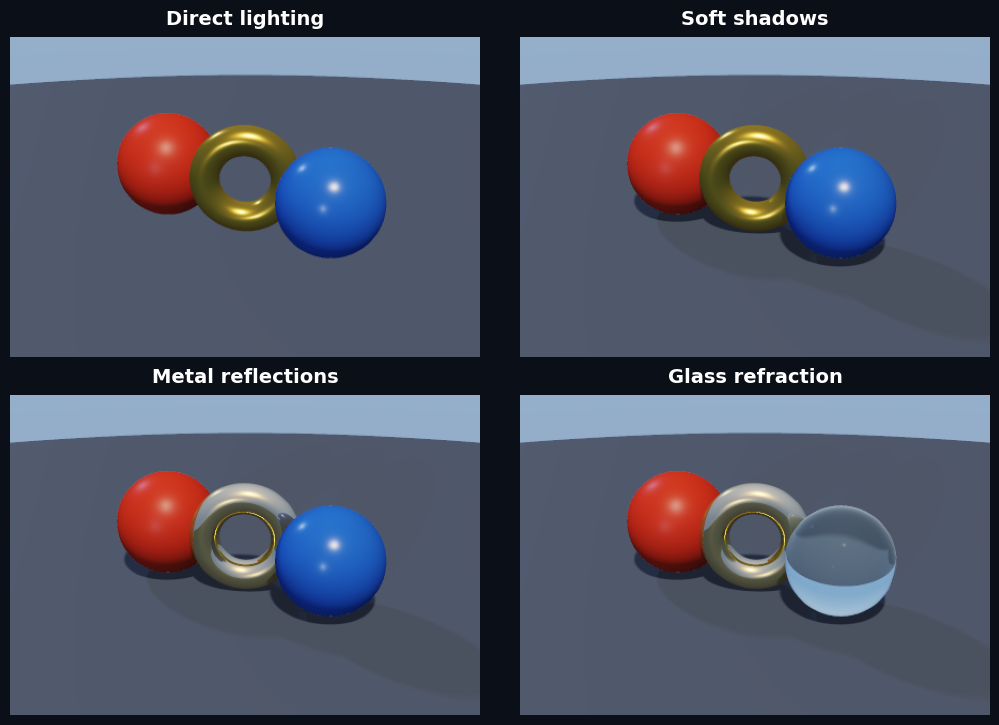

`cadjoint.render` draws an SDF scene to an `(H, W, 3)` float array with
early-exit sphere tracing, finite-difference normals, Cook–Torrance GGX materials, soft shadows and
optional reflection and refraction. The same scene compiles through StableHLO
to a WGSL shader that the interactive viewer renders live.

## Example

```python
from cadjoint.render import Camera, RenderSettings, Scene, render_scene
from cadjoint.sdf.primitives import Sphere

scene = Scene(
    Sphere(1.0),
    camera=Camera(position=(0, 1.5, 5), target=(0, 0, 0)),
)
image = render_scene(scene, RenderSettings.balanced((240, 320)))
print(image.shape)   # (240, 320, 3)
```

## Scene

`Scene` holds the geometry, the camera, the lights and the environment.
`light_directions` and `light_colors` are matched tuples, one entry per light;
`make_gradient_sky` builds an environment map from three colours.

```python
from cadjoint.render import Material, make_gradient_sky
from cadjoint.sdf.boolean import Union
from cadjoint.sdf.primitives import Plane, Torus
from cadjoint.sdf.transforms import Rotate, Translate

geometry = Union(
    Translate(Sphere(0.82, material=Material(color=[0.78, 0.06, 0.03], roughness=0.42)),
              [-1.45, -0.10, 0.0]),
    Translate(Rotate(Torus(0.62, 0.23, material=Material(color=[1.0, 0.58, 0.08],
                                                          roughness=0.28, metallic=0.8)),
                     axis="y", angle=0.45),
              [0.0, -0.07, 0.0]),
    Plane(-0.92, material=Material(color=[0.10, 0.12, 0.16], roughness=0.72)),
    smoothness=0.0,
)
lit = Scene(
    geometry,
    camera=Camera(position=(4.4, 3.5, 7.5), target=(0.0, -0.35, 0.0), fov=0.38),
    light_directions=((0.35, 1.0, 0.55), (-0.65, 0.45, -0.2)),
    light_colors=((1.5, 1.35, 1.15), (0.22, 0.3, 0.5)),
    environment_map=make_gradient_sky(
        sky_color=(0.7, 0.76, 0.88),
        horizon_color=(0.18, 0.27, 0.44),
        ground_color=(0.16, 0.18, 0.24),
    ),
)
image = render_scene(lit, RenderSettings.balanced((180, 240)))
```

The low-level `raymarch(sdf, ...)` takes the geometry and the settings as
keyword arguments; `render_raymarched(...)` wraps it to draw on a matplotlib
axis.

## Quality presets

`RenderSettings` sets the performance/fidelity trade-off, separately from the
scene.

| Preset | Trace steps | Hit ε | Shadow steps | SSAA | Default resolution |
|---|---|---|---|---|---|
| `draft` | 72 | 1.5e-3 | 0 | 1×1 | 200 × 200 |
| `balanced` | 96 | 1e-3 | 32 | 2×2 | 200 × 200 |
| `high_quality` | 160 | 5e-4 | 64 | 3×3 | 400 × 400 |

`draft` is direct lighting with no secondary visibility. `balanced` adds soft
shadows and reconstructed silhouettes. `high_quality` tightens surface
precision and doubles the shadow budget. Reflection and refraction are off in
all three.



Presets are immutable dataclasses. Every field is public and validated;
override one with `dataclasses.replace`:

```python
from dataclasses import replace

mirror = replace(RenderSettings.balanced(), reflect_steps=64)
```

A primary ray stops at the first hit or at `max_distance`, so a direct hit
uses a small fraction of `max_steps` and a miss does not evaluate the field for
every step. Soft-shadow rays stop at the first occluder.

Each primary trace keeps its closest approach to the scene. A ray that narrowly
misses a surface receives screen-space coverage across
`silhouette_smoothing` pixels, which removes hard hit/miss outlines. Set it to
`0` for exact binary coverage.

## Compilation and caching

The first `render_scene` call includes JAX compilation. The renderer is one
module-level `jax.jit`: the scene tree, the image shape and the step counts
(`max_steps`, `shadow_steps`, `reflect_steps`, `refract_steps`) are static, and
the design parameter values are traced inputs. A later call that changes only
parameter values, the camera or the lights reuses the compiled program; a new
preset or resolution compiles once more.

```python
from time import perf_counter

settings = RenderSettings.balanced((128, 160))
render_scene(lit, settings)               # compiles
start = perf_counter()
render_scene(lit, settings)               # cached
print(f"{(perf_counter() - start) * 1e3:.1f} ms")
```

## Materials

Attach a `Material` to any primitive. It is queried per hit point, and `Union`
blends materials across a smooth boundary.

```python
sphere = Sphere(
    radius=1.0,
    material=Material(
        color=[0.22, 0.50, 0.95],
        roughness=0.35,
        metallic=0.0,
        opacity=1.0,
        ior=1.0,
    ),
)
```



### Transparency and refraction

`opacity < 1` makes a surface transparent. With `refract_steps=0` (the
default) it fades toward the background. With `refract_steps > 0` the renderer
refracts twice by Snell's law: the primary ray bends into the material, an
interior march finds the back face using `−sdf` as the distance field, and the
ray bends back into air. Schlick–Fresnel brightens the rim at grazing angles.

```python
import jax.numpy as jnp
from cadjoint.render import raymarch

glass = Sphere(radius=1.0, material=Material(
    color=[0.92, 0.97, 1.0], roughness=0.05, opacity=0.04, ior=1.5))
red_ball = Translate(
    Sphere(radius=0.65, material=Material(color=[0.93, 0.26, 0.22])),
    offset=jnp.array([-1.1, 0.5, -3.0]),
)

image = raymarch(
    Union((glass, red_ball), smoothness=0.0),
    camera_pos=jnp.array([0.0, 0.5, 5.5]),
    resolution=(200, 200),
    background_color=jnp.array([0.07, 0.09, 0.16]),
    refract_steps=48,
    max_steps=80,
    aa_samples=2,
)
```

| Material | `ior` |
|---|---|
| air / disabled | 1.0 |
| water | 1.33 |
| glass | 1.5 |
| diamond | 2.42 |

## Shader compilation

A scene compiles to a standalone WGSL shader. JAX traces distance and material
evaluation and lowers both to StableHLO, from which cadjoint emits the shader
source, so the browser renders the same field as the Python renderer:

```
JAX scene → jax.export → StableHLO MLIR → WGSL → WebGPU fragment shader
```

```python
from cadjoint.backends import compile_scene_to_wgsl, compile_sdf_to_wgsl

wgsl = compile_sdf_to_wgsl(Sphere(radius=1.0))          # `fn sdf` only
scene_wgsl = compile_scene_to_wgsl(Sphere(radius=1.0))  # + materials
print(wgsl[:200])
```

`compile_scene_to_wgsl` emits `sdf`, `material_base` (RGB + roughness) and
`material_optics` (metallic + opacity + IOR + reflectivity) from one scene
snapshot. The whole tree becomes one WGSL function per entry point; the GPU
evaluates the field directly, with no intermediate mesh.
[The playground](viewer.qmd) compiles on every run.

### Shader size

A shader is one straight-line function per entry point, so its size depends on
how much of the tree the trace unrolls. A node evaluated more than once (a
pattern's child, a subtree two booleans share) is lowered as its own StableHLO
function, which the emitter turns into one WGSL function called per instance; a
bearing housing with four polar patterns is 1.45 MB of WGSL rather than
2.42 MB. The vertex loop of a sketch profile is not shared: WGSL has no type
wider than a `mat4`, so a profile's vertices stay individual `vec2`s and its
contribution grows with the vertex count. Everything else traces the profile as
one `(N, 2)` array; see [program size](meshing.qmd#program-size).

### Uniform parameters

Design parameters are inlined as float literals by default, so editing one
rewrites the module and the browser recompiles it. `uniforms=True` returns a
`ShaderProgram`: the same source for every parameter value, plus a
`vec4`-per-parameter uniform layout.

```python
from cadjoint.geometry import Scalar

sized = Sphere(radius=Scalar(1.0, free=True, name="radius"))
program = compile_scene_to_wgsl(sized, uniforms=True)
program.wgsl                 # identical across every value edit
program.parameters[0].name   # 'radius', the name extract_parameters uses
program.buffer()             # float32 array to upload at @group(3) @binding(0)
```

## Notebook viewer

`SDFViewer` renders a compiled scene live in a Jupyter notebook. It needs the
viewer extra (`uv sync --extra viewer`) and a WebGPU-capable browser
(Chrome/Edge 113+).

```python
from cadjoint.sdf.boolean import Difference
from cadjoint.sdf.primitives import Box, Capsule
from cadjoint.viewer import SDFViewer

box = Translate(Box([1.3, 1.3, 1.3]), offset=jnp.array([0.5, 0.3, 0.0]))
viewer = SDFViewer(Difference(Sphere(1.0), box, smoothness=0.05), height=400)
viewer
```

| Input | Action |
|---|---|
| left-drag | orbit |
| scroll | zoom |
| right-drag | pan |
| double-click | reset |

`update_scene` swaps in a new field. The camera keeps its position; only the
shader recompiles.

```python
viewer.update_scene(
    Union(
        Sphere(0.9),
        Translate(Capsule(radius=0.3, height=1.4), offset=jnp.array([1.2, 0.0, 0.0])),
        smoothness=0.15,
    )
)
```

For the full scene editor, with path tracing and field views, see
[the playground](viewer.qmd); its path tracer is described in
[WebGPU SDF path tracing](https://github.com/andrinr/cadjoint/blob/main/research/path-tracing.md).

## Limitations

- Rendered pixels are not differentiable: visibility carries no gradient, and
  the renderer is not an inverse-rendering or optimization interface. Gradients
  run through [meshing](meshing.qmd) and [simulation](simulation.qmd).

## API

- [`render.Scene`](../reference/render.Scene.qmd)
- [`render.Camera`](../reference/render.Camera.qmd)
- [`render.RenderSettings`](../reference/render.RenderSettings.qmd)
- [`render.render_scene`](../reference/render.render_scene.qmd)
- [`render.raymarch`](../reference/render.raymarch.qmd)
- [`render.render_raymarched`](../reference/render.render_raymarched.qmd)
- [`render.make_gradient_sky`](../reference/render.make_gradient_sky.qmd)
- [`Material`](../reference/Material.qmd)
- [`backends.compile_scene_to_wgsl`](../reference/backends.compile_scene_to_wgsl.qmd)
- [`backends.compile_sdf_to_wgsl`](../reference/backends.compile_sdf_to_wgsl.qmd)
- [`backends.wgsl.ShaderProgram`](../reference/backends.wgsl.ShaderProgram.qmd)
- [`viewer.widget.SDFViewer`](../reference/viewer.widget.SDFViewer.qmd)
