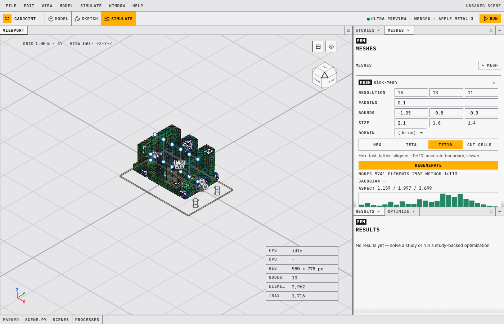

`cadjoint.fem` turns an SDF into a finite-element solution. The
discretization and the physics are declared as objects in the scene file (a
`SimMesh` and a study), because the same declarations are read by the
playground's Meshes and Studies windows, re-solved by the optimizer, and
refrozen whenever the geometry moves.

The solvers need the `fem` extra (see [install](getting-started.qmd#install)):

```bash
uv sync --extra fem
```

## Meshes

A `SimMesh` names a discretization of an SDF over a sampling lattice.

```python
from cadjoint.fem import SimMesh
from cadjoint.geometry.parameters import Vector
from cadjoint.sdf.primitives import Box

bar = Box(Vector([1.0, 0.15, 0.15], free=True, name="size"))

mesh = SimMesh(
    name="bar-mesh",
    resolution=(22, 5, 5),
    bounds=(-1.1, -0.25, -0.25),
    size=(2.2, 0.5, 0.5),
)

print(mesh.inspect(bar))
# {'name': 'bar-mesh', 'method': 'hex', 'nodes': 336, 'elements': 180, ...}
```

`bounds` and `size` give the corner and extent of the lattice and are
supplied together; without them the mesh scans for the bounds, padded by
`padding`. `resolution` is the lattice, not the element count; for tets it is
the dual-contouring extraction grid.

`method` takes four values:

| `method` | `MeshMethod` | Element | How it is built |
|---|---|---|---|
| `"hex"` (default) | `MeshMethod.HEX` | HEX8 | Voxelize the lattice, Newton-snap boundary nodes onto the SDF. Fast, lattice-aligned, deterministic across platforms. |
| `"tet4"` | `MeshMethod.TET4` | TET4 | Dual-contour the surface, fill it with TetGen. Boundary-conforming. |
| `"tet10"` | `MeshMethod.TET10` | TET10 | The TET4 mesh promoted to straight-sided quadratic tets. Accurate boundary, slower. |
| `"cutfem"` | `MeshMethod.CUTFEM` | none | No volume mesh: the lattice's cells are the elements, the ones the surface passes through are cut by it, and the boundary is handled weakly (CutFEM). The surface is extracted only to be drawn and selected on. Thermal studies only, numeric conductivity. |

`method="tet10"` and `method=MeshMethod.TET10`
(`from cadjoint.enums import MeshMethod`) are the same declaration, because a
`MeshMethod` is a `str`. The enum defines the option set, so a typo is rejected
with the list of accepted values.

`"cutfem"` has no mesher. Nothing is voxelized or tetrahedralized: the study
assembles on the lattice's cut cells, a design change moves the cut rather than
the nodes, and the gradient of a `metric="mean"` optimization comes through the
quadrature at fixed structure (`gradient_path="direct"`; the Tesseract chains
expect a mesh). The end cap uses it. It is thermal-only, requires a numeric
conductivity (materials are not sampled on cut cells), and a thin feature needs
a cell size well under its thickness for meaningful numbers. The first solve on
a given structure compiles its quadrature.

The tet methods need the `tetgen` package. On the same bar, `"tet10"` gives 947
nodes and 448 elements against the hex mesh's 336 and 180. A surface TetGen
rejects as self-intersecting is re-extracted on a finer grid over the same box
before the build fails, and the mesh records which grid it was built on; see
[the refinement ladder](meshing.qmd#the-refinement-ladder).

Whatever the method, the rest of the code holds a discretization
(`cadjoint.fem.discretization`) that answers for its own surface, element
quality, the nodes and facets a selection picks, how it moves with the design,
and which solver runs on it. Studies, the optimizer and the viewer query it
rather than branching on the mesh family.

Tets sized by the part rather than the lattice come from Gmsh,
`SimMesh(mesher="gmsh")`; see [Gmsh](meshing.qmd#the-gmsh-route).
Its midside nodes sit on the true surface, but whether they follow the design
parameters depends on the `node_map` plugin kind. Nothing in this repository
fills it, so the mesh reports frozen geometry; see
[kinds that can be filled](getting-started.qmd#pluggable-kinds).

## Mesh quality

`quality()` returns per-element metric arrays; `inspect()` reduces them to
min/mean/max alongside the counts and bounds. Hex meshes report
`scaled_jacobian` and `aspect_ratio`; tet meshes report `radius_ratio`
(3·r_in/r_circ, in (0, 1], higher is better) and `aspect_ratio` (longest over
shortest edge, ≥ 1). Cut cells report no metrics; the Meshes window
draws their surface uncoloured.

```python
q = mesh.quality(bar)
print(sorted(q))  # ['aspect_ratio', 'scaled_jacobian']
```

A voxelized hex mesh of an axis-aligned bar has every metric exactly 1.0. The
tet10 mesh of the same bar spans radius ratios from 0.146 to 0.941; the
playground's Meshes window shows that spread as a histogram.



## Node selections

Boundary conditions attach to node selections, not to face groups or index
lists. `Nodes` is a factory namespace whose selections are evaluated against
the mesh they are given, so they survive re-meshing and a change of shape.

| Factory | Selects |
|---|---|
| `Nodes.side("+x")` | One face of the bounding box, within a per-mesh tolerance (`"+x"`…`"-z"`, or a `Side` member) |
| `Nodes.box(min_corner, max_corner)` | Inside an axis-aligned box |
| `Nodes.sphere(center, radius)` | Inside a ball |
| `Nodes.halfspace(point, normal)` | Where `dot(x - point, normal) >= 0` |
| `Nodes.cylinder(center, axis, radius, inner=0, half_length=None)` | Within `radius` of the line through `center` along `axis`; `inner` hollows it into an annulus, `half_length` bounds it axially |
| `Nodes.predicate(fn)` | A vectorized `(N, 3) -> (N,)` boolean callable |

Three operators combine them: `&` (intersection), `|` (union), and `~`
(complement). There is no `-`; write a set difference as `a & ~b`.

```python
from cadjoint.fem import Nodes

hot = Nodes.halfspace([0, 0, -0.12], [0, 0, -1]) & Nodes.sphere([0, 0, -0.18], 0.4)
ends = Nodes.side("-x") | Nodes.side("+x")
just_one_end = Nodes.side("-x") & ~Nodes.side("+x")
```

Selections resolve to boundary nodes only, so `~sel` is the rest of the
surface, never the interior. `sel.mask(mesh)` gives the boolean array and
`sel.resolve(mesh)` the indices; `resolve` raises on an empty selection, which
catches a boundary condition that has drifted off the part during an
optimization.

## Studies

`ThermalStudy` solves steady-state conduction; `ElasticStudy` solves linear
elasticity. Both take a `SimMesh` and a list of boundary conditions. Material
properties are keyword-only: pass a number, or omit them and the scene's
materials supply them per element (see
[material properties](#materials-drive-the-solve)).

```python
import numpy as np
from cadjoint.fem import Dirichlet, Nodes, SimMesh, ThermalStudy
from cadjoint.geometry.parameters import Vector
from cadjoint.sdf.primitives import Box

bar = Box(Vector([1.0, 0.15, 0.15], free=True, name="size"))
mesh = SimMesh(name="bar-mesh", resolution=(22, 5, 5),
               bounds=(-1.1, -0.25, -0.25), size=(2.2, 0.5, 0.5))

study = ThermalStudy(
    name="bar-conduction",
    conductivity=2.0,
    bcs=[
        Dirichlet(Nodes.side("-x"), 1.0),
        Dirichlet(Nodes.side("+x"), 0.0),
    ],
    mesh=mesh,
)

result = study.solve(bar)
temperature = np.asarray(result.temperature)
x = result.mesh.points[:, 0]
print(np.abs(temperature - (1.0 - x) / 2.0).max())  # 4.4e-10
```

The exact solution is a linear ramp between the two prescribed ends, and the
solve reproduces it to 4.4e-10.

The boundary conditions are `Dirichlet(nodes, value)` and `HeatFlux(nodes, flux)`
for thermal, `Fixed(nodes)` and `Traction(nodes, vector)` for elastic. A thermal
study needs at least one `Dirichlet` and an elastic study at least one `Fixed`;
otherwise the system is singular and `solve` raises. `HeatFlux` and `Traction` are
integrated over boundary faces, so their selection has to span complete faces
rather than isolated nodes.

Explicit scalars carry no units: `conductivity`, `youngs`, `poisson`,
`source`, `flux` and `vector` are floats in any consistent system. Properties
from a `Material` are SI (W/(m·K), Pa, kg/m³), so a scene that mixes the two
must be in SI throughout.

An elastic study:

```python
from cadjoint.fem import ElasticStudy, Fixed, Nodes, SimMesh, Traction

study = ElasticStudy(
    name="bar-bending",
    youngs=200.0,
    poisson=0.3,
    bcs=[Fixed(Nodes.side("-x")), Traction(Nodes.side("+x"), (0.0, 0.0, -0.5))],
    mesh=SimMesh(name="bar-hex", resolution=(22, 5, 5),
                 bounds=(-1.1, -0.25, -0.25), size=(2.2, 0.5, 0.5)),
)
```

`mesh=` and the inline meshing keywords (`resolution`, `bounds`, `size`,
`domain`) are mutually exclusive.

## Material properties {#materials-drive-the-solve}

A single scalar cannot describe a design with two materials: a copper slug in
an aluminium sink has no meaningful average conductivity. A property omitted
from the study (or passed as the sentinel `"material"`) comes from the scene's
materials, sampled per element at solve time:

```python
import jax.numpy as jnp
from cadjoint.fem import Dirichlet, HeatFlux, Nodes, SimMesh, ThermalStudy
from cadjoint.materials import aluminium_6061, copper_c11000
from cadjoint.sdf.boolean import Union
from cadjoint.sdf.primitives import Box
from cadjoint.sdf.transforms import Translate

sink = Translate(Box([0.5, 0.15, 0.15], material=aluminium_6061()),
                 offset=jnp.array([0.5, 0.0, 0.0]))
slug = Translate(Box([0.5, 0.15, 0.15], material=copper_c11000()),
                 offset=jnp.array([-0.5, 0.0, 0.0]))
scene = Union((sink, slug), smoothness=0.03)

study = ThermalStudy(                       # no conductivity= at all
    name="two-metal-bar",
    bcs=[HeatFlux(Nodes.side("-x"), 4.0), Dirichlet(Nodes.side("+x"), 0.0)],
    mesh=SimMesh(name="bar-mesh", resolution=(22, 5, 5),
                 bounds=(-1.1, -0.25, -0.25), size=(2.2, 0.5, 0.5)),
)
result = study.solve(scene)
print(result.describe()["range"], result.mass)   # [0.0, 0.0335] 1062.4
```

Every SDF answers `material_at(p)` and the smooth booleans blend the answers,
so the scene is a continuous field of properties. Sampling it at each element's
centroid gives the per-element array the solver takes:
copper's 391 W/(m·K) in the left half, aluminium's 167 in the right, and a
transition exactly as wide as the CSG blend joining them. The 4 W/m² entering
the copper end crosses the bar with a 0.034 K rise, and because both materials
state a density the result reports the bar's 1062 kg as well (the scene is in
metres, so it is a two-metre bar).

An explicit `conductivity=2.0` means 2.0 everywhere and takes the scalar code
path; the per-element array exists only when a study requests it. The
starter's single-material thermal solve costs the same on either path (0.185 s
against 0.175–0.181 s warm, peak temperature bit-identical).

### Derived properties

| Study | Property | Material key |
|---|---|---|
| `ThermalStudy` | `conductivity` | `conductivity` |
| `ElasticStudy` | `youngs` | `youngs_modulus` |
| `ElasticStudy` | `poisson` | `poisson_ratio` |

Two more properties are read for reporting, not solving; a scene without them
still solves but does not report them:

- `density` becomes `result.mass` (kg), the exact element-wise
  `sum(rho_e * V_e)`, traced whenever the solve was.
- `yield_strength` becomes `result.safety_factor` on elastic results: the
  smallest `yield / von Mises` over the elements, i.e. how far the whole load
  case could be scaled before the first element yields.

### Self-weight

An elastic study given a `gravity` vector adds `density * gravity` as a body
force. The materials must state a density, or the study raises:

```python
ElasticStudy(
    name="sag",
    gravity=(0.0, 0.0, -9.81),      # m/s^2, SI throughout
    bcs=[Fixed(Nodes.side("-x"))],
    mesh=mesh,
)
```

### Gradients

The sampled property field is differentiable with respect to both geometry
and material:

- **Geometry** — the blend at an interface moves when the design does, so
  `d(objective)/d(interface position)` flows through the material field.
- **Material** — a property marked `free` is traced straight through
  `Material.as_dict()`, so an optimizer can tune a conductivity and a shape in
  one gradient.

Both are checked against central finite differences in
`tests/fem/test_material_properties.py` on a two-material bar with the interface
position *and* a conductivity free. Measured agreement at that operating point:
the conductivity sensitivity matches to 4e-6, and the interface sensitivity
converges to the adjoint as the difference step shrinks — 10 % off at h = 4e-3,
4.3 % at 1e-3, 0.17 % at 2e-4 (the objective is sharply curved there, because the
blend is 0.06 wide and the elements are 0.1).

### Backend support

| Backend | Per-element properties | Body force |
|---|---|---|
| `"jaxfem"` | Yes — carried as jax-fem `internal_vars`, differentiable | Yes |
| `"tesseract"` | Yes — optional `cell_conductivity` / `cell_youngs` / `cell_poisson` schema inputs, bit-identical to the direct path | Yes (`body_force`) |
| `"calculix"` | Approximated — see below | No (`NotImplementedError`) |

CalculiX takes named materials, not per-element arrays: a deck describes them
with `*MATERIAL` / `*ELSET` / `*SOLID SECTION`, so the format cannot represent a
blended interface exactly.

The deck writer groups elements whose properties agree to a tight relative
tolerance, so each sharp region becomes one group and the deck is exact for a
two-material part with a crisp interface. Past `max_material_groups` (default
32), which only a blended field reaches, each element snaps to its nearest
reference material in log-property space. References default to the field's
dominant materials, or pass `cadjoint.materials.catalogue()` to snap to named
ones. The solution carries a `MaterialQuantization` record (elements moved,
maximum relative property error, reference names), and a
`CalculixQuantizationWarning` fires whenever any element moved.

## Results

`solve` returns a `SimulationResult` and also stores it on `study.last_result`.

```python
print(result.describe())
# {'name': 'bar-conduction', 'kind': 'thermal', 'field': 'temperature',
#  'mesh': 'bar-mesh', 'nodes': 336, 'elements': 180, 'range': [0.0, 1.0], ...}
```

`mass` and `safety_factor` are on the result and in `describe()`, `None`
whenever the scene's materials do not make them computable.

`temperature` (thermal) and `displacement` / `von_mises()` (elastic) give the
raw fields; `nodal_scalar()` gives the per-node field the viewer colours by.
`mean()` and `max()` are the reductions an objective should use: they work
under `jax.grad`, where the concrete accessors do not. `to_vtk(path)`
writes the result out for ParaView.


## Backends

`solve(backend=...)` selects the solver; the default is `"jaxfem"`.

| Backend | Runs | Needs | Gradients |
|---|---|---|---|
| `"jaxfem"` | jax-fem in-process | `fem` extra | jax-fem's `ad_wrapper` adjoint; also differentiable w.r.t. prescribed Dirichlet values |
| `"tesseract"` | the same jax-fem solve behind a Tesseract | `fem` + `tesseract` extras | the Tesseract's `vector_jacobian_product` endpoint — bit-identical to the in-process path |
| `"calculix"` | the CalculiX 2.23 Fortran binary as a subprocess | `tesseract` extra and a `ccx` binary | ccx's own `*SENSITIVITY` discrete adjoint, plus a correction for a term missing in 2.23 |

The three built-in names are `cadjoint.enums.FemBackend` (`FemBackend.JAXFEM`
and so on). Unlike the other option sets this one is open:
`available_backends()` lists what is registered and
`register_backend(name, factory)` adds a backend under any name, so `backend=`
takes a plain string. The ABI is the `SolverBackend`
protocol in `cadjoint.fem.backends`, two methods wide. The
[simulator ecosystem survey](https://github.com/andrinr/cadjoint/blob/main/research/simulator-ecosystem.md)
ranks 31 further candidates for that slot.

`"tesseract"` and `"calculix"` name plugin kinds, not packages.
`"tesseract"` asks the [plugin registry](plugins.qmd) for whatever fills the
`thermal_solver` or `elastic_solver` slot, and `"calculix"` for the
`elastic_calculix` plugin — so a `plugins.toml` that points that kind at a
container or a cluster URL moves the solve without changing the study.

CalculiX is elastic and HEX8 only, and its derivative is objective-valued:
cotangents on the raw displacement field are refused, because what ccx
differentiates is a strain energy. And tet meshes
(`"tet4"` / `"tet10"`) solve on the direct jax-fem path only — use a hex
`SimMesh` for the other backends. Cut cells (`"cutfem"`) are their own
solver and take no backend at all.

Forward solves are not `jax.jit`-able, because PETSc assembly happens outside
the trace. Each backend call enables x64 for its own duration, but code that
differentiates *through* a solve has to set it process-wide itself:

```python
import jax
jax.config.update("jax_enable_x64", True)
```

## Further reading

- [FEM integration](https://github.com/andrinr/cadjoint/blob/main/research/fem-integration.md) — the `SolverBackend` ABI, adjoint mechanics, and the ccx 2.23 sensitivity correction.
- [Materials](materials.qmd) — the property field a study samples, and the catalogue of real values.
- [Meshing](meshing.qmd) — the surface extractor underneath the tet methods.
- [Optimization](optimization.qmd) — making a study the objective of a descent.
