The playground is a local browser application with a Python editor, a WebGPU
viewport, and windows that edit the program in the editor. The program holds
all state. Every edit in the UI — dragging a sketch vertex, adding a boundary
condition, accepting an optimized design — rewrites literals in the source,
and every window is rebuilt from the next compile. Geometry whose literals
cannot be rewritten (built in a loop, or from a variable) renders but is
read-only.

[](assets/screens/model-desk.png)

## Starting the server

The playground ships in the `cadjoint` package as `cadjoint-viewer`. It needs
the `viewer` extra; `editor` adds lint, completion and signature help.

```bash
uvx --from "cadjoint[viewer,editor]" cadjoint-viewer --open   # no checkout, no environment
pip install "cadjoint[viewer,editor]" && cadjoint-viewer --open
```

From a checkout:

```bash
uv sync --extra viewer --extra editor
uv run cadjoint-viewer --open                 # serves http://127.0.0.1:8765/ and opens a browser
uv run python -m cadjoint.viewer.playground   # same server, no browser launch
uv run cadjoint-viewer --port 9000            # another port; --help lists the flags
```

Scenes open from and save to `./scenes` under the directory the server was
started in, or `CADJOINT_SCENES_DIR`. In a checkout that is the example
scenes; elsewhere it starts empty. The playground opens on a built-in starter,
a **parametric heat sink**: a fin comb extruded from one constrained sketch, a
revolved copper slug under the die, two steel bushings, and a declared mesh,
thermal study and optimization. The viewport needs a WebGPU-capable browser.
Stop the server with `Ctrl+C`.

::: {.callout-warning}
The playground executes the editor contents as Python on your computer. It binds
only to localhost, protects requests with a per-session token, and compiles
each edit in a timed child process so a failing edit cannot take the server
down — but it is not a sandbox. Only run code you trust.
:::

## Layout

The **menu bar** has seven menus and, at its right end, the scene's file name (`UNSAVED SCENE` until it is saved). The
**toolbar** holds, left to right:

| Control | Does |
|---|---|
| Mode switcher | Model · Sketch · Simulate; `M` cycles, `⇧M` cycles back |
| Job chip | Present only while work runs: kind, name, step, elapsed time; click opens Processes, `×` stops it |
| Selection chip | The selected object's name, or `vertex n` |
| Status | The last result, e.g. `ULTRA PREVIEW · WEBGPU · APPLE METAL-3`, or the error |
| `removed … Undo ⌘Z` | Shown after a removal; nothing is deleted behind a confirmation dialog |
| Run | Compiles the editor (`⌘↵`); reads `Run •` while the text differs from the last run |

While the picture lags the code, the rule under the toolbar thickens and
fills with the accent colour.

Below are the **windows**: scene.py, Viewport, Objects, Properties, Sketch,
Materials, Meshes, Studies, Results, Optimize, Scenes and Processes. Each can
be dragged to split the desk, tabbed with another, floated (the `◱` button, or
Window › Float the focused window), minimised to the **tray** at the bottom
(`−`) or closed (`×`); Window › Windows reopens any of them by its tab name.
The viewport cannot be closed, and its WebGPU context survives every move.

A **mode** sets the tool rail and a default arrangement, which it remembers
once you change it; Window › Reset layout restores the default.

| Mode | Default windows beside the viewport | Rail |
|---|---|---|
| **Model** | scene.py; Objects over Properties over Materials, Optimize tabbed behind | Select, Create, Shape, Transform, Delete |
| **Sketch** | scene.py; Objects over Properties over Sketch | as Model, plus Constrain |
| **Simulate** | scene.py; Studies (Meshes behind) over Results (Optimize behind) | none: the viewport probes the field and picks boundary conditions |

Every mode keeps the same column widths, so a mode change never moves the
viewport. Selecting a sketch profile enters Sketch mode; `Esc` walks back to
Model. Scenes and Processes are parked in the tray in every mode.

## Viewport

[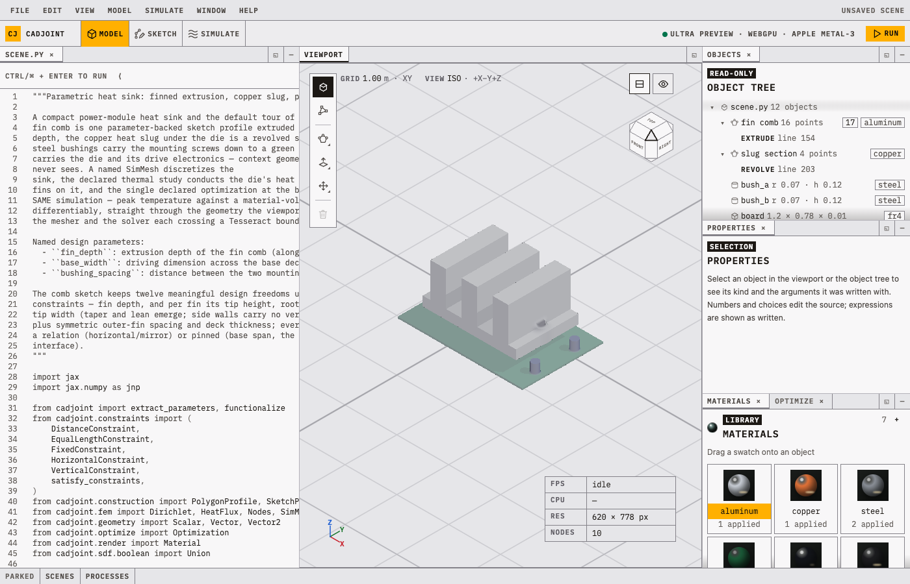](assets/screens/construction-overlay-off.png)

| Where | What |
|---|---|
| Top left | The tool rail, and beside it the grid readout: `GRID 1.00 m · XY` (spacing on a 1-2-5 ladder, and the world plane it rules) and `VIEW ISO · +X−Y+Z`; a `>` prefix means the view is not to scale |
| Top right | The viewport bar — projection toggle and **Render** settings — over the view cube |
| Bottom left | The axis triad (X red, Y green, Z blue); in Simulate, the field legend |
| Bottom centre | The hint, shown only while a step is in progress or a handle or plane is hovered |
| Bottom right | The performance readout: FPS (`idle` when nothing redraws), CPU ms/frame, RES, NODES, and ELEMENTS and TRIS while a mesh is shown |

The world is Z-up and the default projection is orthographic. The grid and the
performance readout hide together under Render › Annotations › Ground grid.

| Input | Effect |
|---|---|
| Drag empty space | Orbit |
| `⇧`-drag, right-drag, or hold `Space` and drag | Pan |
| Wheel | Zoom |
| `⌥`-wheel, `[` / `]` | Zoom in / out one grid step |
| View cube face, edge or corner | One of 26 standard views; `⇧`- or `Ctrl`-click for the opposite one |
| `1` `3` `7` | Front, right, top; with `Ctrl`, back, left, bottom |
| `9` | Turn to the opposite side |
| `5`, or the projection toggle | Orthographic / perspective |

The camera has no roll; up is always world +Z.

**Construction overlay** (`⇧C`, View › Show › Construction) hides sketch edges
and handles, the gizmo, constraint marks, dimension labels and the
boundary-condition preview, leaving the solid, the field and the floor.
**Layout grid** (`⇧G`) overlays the interface's 4 px grid and outlines in red
any element that sits more than a pixel off it.

## Modelling

### Tools

The tool rail floats in the viewport's top-left corner. A group button shows its
last-used tool; hover or click opens a flyout of the rest. At 1280 px and wider
each button carries its word. A tool that cannot act says why in its tooltip
(`Extrude — select a sketch first`).

| Group | Tools | Keys |
|---|---|---|
| Select | Object, Vertex | `O`, `V` |
| Create | Sketch, Sketch on face, Point; in Model also Box, Sphere, Cylinder | `K`, —, `P`, `B` `S` `C` |
| Shape | Extrude, Revolve, Loft (applies to the selected sketch) | `E` |
| Transform | Move, Rotate, Scale gizmo | `G`, `R`, `T` |
| Constrain (Sketch mode) | Distance, Horizontal, Vertical, Coincident, Parallel, Perpendicular, Fix | — |
| Delete | Removes the selection | `⌫` |

One tool is armed at a time; finishing or cancelling it returns to Select.

- **Sketch** places a new sketch on the plane chosen in the rail's `plane` row
  (XY, YZ, ZX, or Face); a ghost shows where it lands.
- **Point** inserts a vertex wherever you click a sketch edge, until `Esc`.
- **Box / Sphere / Cylinder** write a `Solid.*` call where you click.
- **Loft** waits for a click on a second sketch with the same vertex count.
- **Distance, Horizontal, Vertical, Coincident** take two sketch points;
  **Parallel, Perpendicular** two edges; **Fix** anchors the selected point.
- The gizmo's arrows and rings rewrite `position=`, `rotation=` or the size
  arguments; Scale needs a solid primitive.

### Selecting and editing

A click selects; the viewport, Objects, Properties and the editor show the same
selection, and the editor scrolls to its source without taking focus. A vertex
selection highlights its exact literal. Click empty space, or `Esc`, to clear.

A **free** sketch point — a parameter the optimizer may move — is a hollow blue
ring and the solid follows the drag live; a **held** point is a filled ink
square and the solid catches up after release and a recompile; the selected
point is a filled circle. Hovering a handle names it in the hint. A drag writes
the source once, on release, as one undo step; `Esc` during the drag puts the
value back.

**Objects** is the read-only tree of the scene: sketches with their point
counts and the features built from them, primitives with their dimensions,
each with its material. Clicking a feature row (`EXTRUDE line 154`) points
Properties at it.

**Properties** lists the arguments the selected element was written with.
Literal numbers and vectors are fields, a material is a dropdown of the
program's materials, and anything written as an expression is shown as written,
read-only. A field commits on Enter or blur, keeps its written precision, and
shows its unit beside it. When Properties shows a tree row rather than the
selection, **follow selection** returns it to the viewport's selection.

**Sketch** shows the selected sketch's constraints as chips
(`distance · P1–P2 = 1.8 ×`): a distance's number is editable, `×` (or `⌫` on a
selected chip) removes one. Its buttons are Fix, Extrude, Revolve, Loft and
**Solver**, which runs the constraint solver (Newton projection, Adam or SGD,
for a chosen iteration count) and plots its residual.

[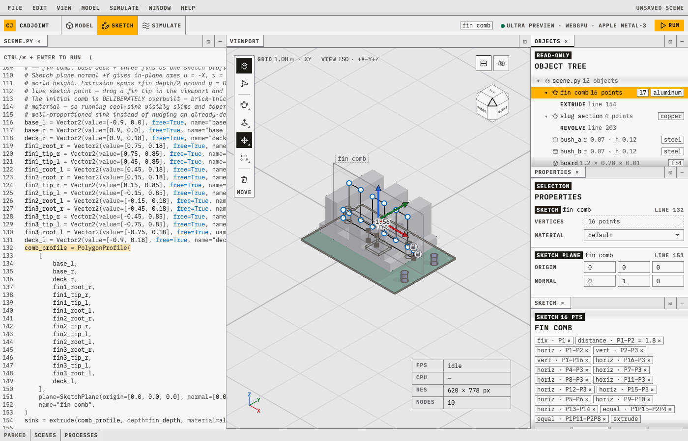](assets/screens/sketch-constraints.png)

### Sketch on face

**Sketch on face** writes a *reference* to the face, not its current
coordinates: `SketchPlane.on(body.cap("+"))`, `SketchPlane.on(block.face("+z"))`,
or, on a curved surface with no face to name,
`SketchPlane.tangent(body, near=[...])`. Re-dimension the parent and the sketch
moves with it, and gradients downstream still reach the parent's parameters —
see [faces as references](modelling.qmd#faces).
In Model it starts a new sketch; in Sketch it re-plants the selected one. A
face whose feature is not bound to a variable has no name in the source, and
the hint says so. A sketch can only sit on geometry built before it.

### Undo and Escape

Undo (`⌘Z`, `⇧⌘Z` to redo) steps through source versions: each run, patch and
drag is one step; inside the editor it is the editor's own history. Removing
an object, constraint, study, boundary condition, mesh or optimization is not
confirmed — the toolbar shows `removed … Undo ⌘Z` instead.

`Esc` cancels one thing per press, most specific first: a drag in flight, a
half-finished command (a constraint's second pick, a loft's second sketch), the
armed tool, the selection, then the mode. With nothing left it does nothing.

## Materials

**Materials** shows a swatch per `Material` in the program and how many
objects use it. Drag a swatch onto an object in the viewport to assign it;
Properties' material dropdown does the same. `+` (or Model › Create ›
Material) declares a new one.

The inspector has two sections. **Appearance** — colour, roughness, metallic,
opacity — uses a colour picker and sliders. **Physical** is what the solver
reads, in SI, with the unit beside each field: a stated property is a field with `×` to remove it, an
unstated one a **state** button that writes the keyword into the call. A
property written as an expression is shown and not edited.

Values are held to the same brackets `Material` enforces with `free=True`, so a
number the inspector accepts is one the optimizer accepts. A refusal appears
under its row and names the unit — `` `density` must be a number from 1 to
25000 kg/m^3. ``

| Property | Range | Unit |
| --- | --- | --- |
| `density` | 1 – 25000 | kg/m^3 |
| `conductivity` | 0.001 – 3000 | W/(m·K) |
| `specific_heat` | 1 – 10000 | J/(kg·K) |
| `youngs_modulus` | 1000 – 1e12 | Pa |
| `poisson_ratio` | 0 – 0.499 | — |
| `thermal_expansion` | 0 – 0.001 | 1/K |
| `yield_strength` | 1000 – 1e11 | Pa |
| `roughness`, `metallic`, `opacity`, `reflectivity` | 0 – 1 | — |
| `ior` | 1 – 3 | — |

A material from a [catalogue](materials.qmd) factory (`alu =
aluminium_6061()`) has no keyword to edit. The refusal offers **Write it out as
a Material(…)**, which rewrites the binding as the literal call, one keyword
per line, and then applies the edit. Only a bare, argument-free factory call is
converted, so the server never runs your code to do it.

Under the hood every edit is one `set_material_property` patch, naming the
material and carrying the property and a number, or `null` to remove it:

```json
{"op": "set_material_property", "id": "assign:copper",
 "property": "youngs_modulus", "value": 1.185e11}
```

## Simulating

Meshes, Studies, Results and Optimize edit the declarations a script reads;
the Simulate menu reaches them from any mode. Every option they offer — mesh
method, study kind, boundary-condition type, objective — is one of the
`cadjoint.enums` option sets.

**Meshes** has a card per `SimMesh`: resolution, padding, bounds, size, domain,
and the method — Hex, Tet4, Tet10, or Cut cells (thermal studies only, solved
by CutFEM on the lattice). **Generate mesh** builds it, reports node and element
counts, and shades it by element quality with a histogram. A tet mesh that had
to climb the [refinement ladder](meshing.qmd#the-refinement-ladder) says which
grid it was built on. With no `SimMesh` declared, the window offers to generate
a study's implicit mesh.

**Studies** has a card per study: its coefficients, its mesh and domain as
dropdowns, its boundary conditions, and **Solve** (which becomes **Stop** while
it runs). **+ Boundary condition** opens a builder: a type, a selection (Side,
Box, Sphere, Half-space) and a value. **Pick in viewport** arms the viewport:
a click on the mesh proposes a `Nodes.sphere` sized from the mesh spacing, a
`⇧`-drag a `Nodes.box` around the vertices inside the rectangle. The proposal
only fills the builder; **Add** writes it into the program as a selection
expression that re-resolves against whatever the mesh becomes. Hovering a BC
row paints its nodes on the mesh. A study without `conductivity=` (or
`youngs=` / `poisson=`) takes the property from the scene's
[materials](materials.qmd).

[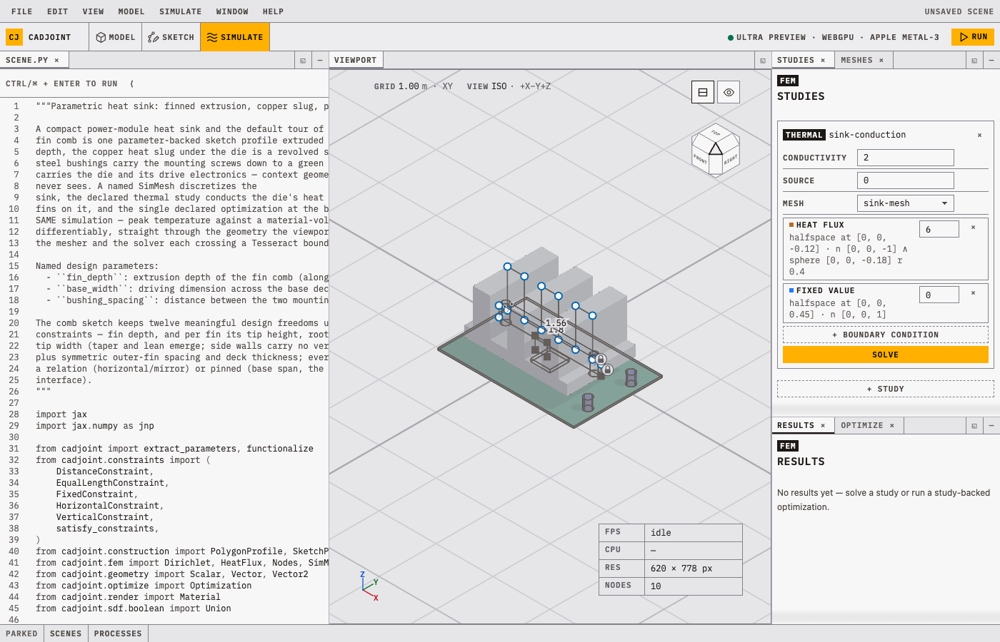](assets/screens/simulate-studies.png)

**Results** shows the solved field in the viridis ramp, which nothing else in
the app uses. Its controls: a field picker that swaps scalars without re-solving, the min / mean / max
table, **View mesh quality**, **Deformed** with a warp scale for elastic
results, **Scene / Mesh** to switch the viewport between the raymarched scene
and the mesh, **Element edges**, and an axis-aligned **Slice**. Clicking the
field probes the nearest vertex. A result whose source has since changed is
kept and marked `stale · source changed`.

[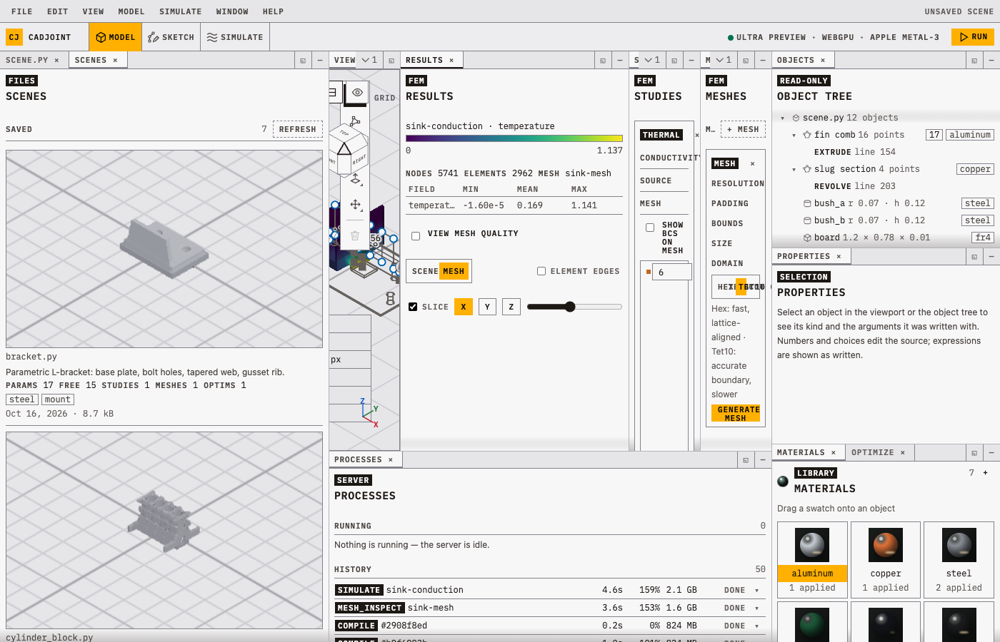](assets/screens/simulate-results.png)

**Optimize** has a card per `Optimization`: its objective, steps and learning
rate, **Run** and **Stop**. While it runs, the card shows the step, the time
per step and the objective so far. A finished run writes the optimized literals
into the source and opens a player — a convergence sparkline, play/pause and a
scrubber (`←` `→`) — that replays the geometry along the trajectory by
ghost-compiling each step's parameters; only the final source enters undo
history. A study-backed run also lands in Results, showing
the optimized design's field.

[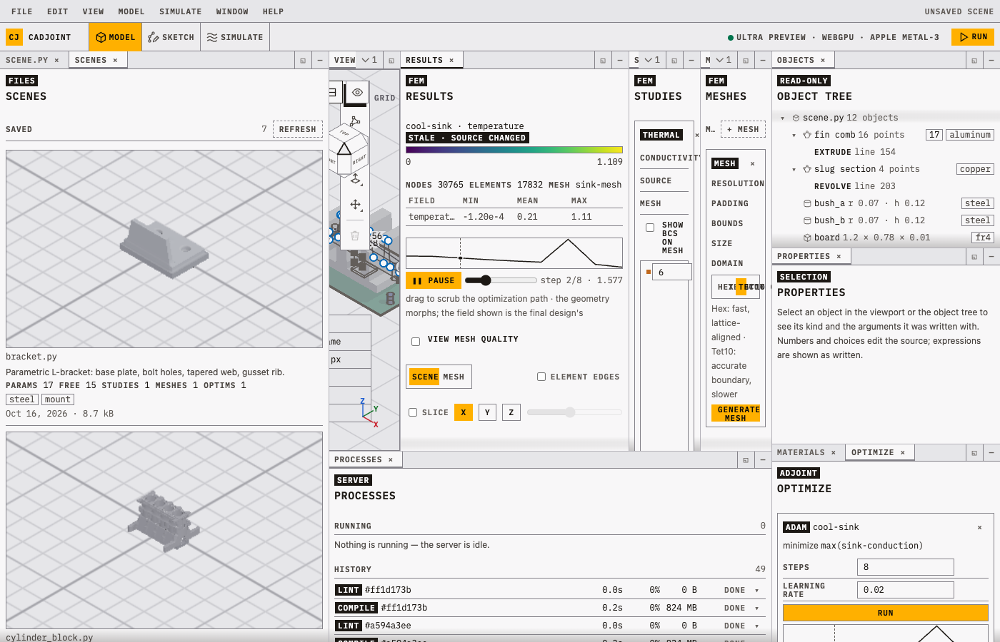](assets/screens/optimize-replay.png)

## Render settings

**Render**, in the viewport bar (also View › Render › Settings…), opens the
render popover in any mode. It holds three editable
presets — **X-Ray** for modelling, **Studio** for path-traced materials,
**Wire** for construction only — stored in the browser; **Customize** opens
the settings under the selected preset, with Save and Reset.

| Section | Controls |
|---|---|
| Distance field | Solid, Slice, ∇f, N, Z; Capped section; slice axis and position; iso offset |
| Shading, Shadows | Full / Flat; Off / Hard / Soft |
| Resolution | Draft, High, Ultra |
| Marching | Step cap, Refine hit |
| Diagnostics | Bounds culling |
| Effects | Path tracing, X-ray, Reflections, Hide solid, Feature edges, Mesh wireframe, B-rep inspector |
| Annotations | Ground grid, Construction overlay, Sketch geometry, All sketch planes, Constraints (Fixed badges, Distance dimensions, Dimension values) |

### Distance-field views

All five views are branches of the one generated shader, reading the same
`sdf()` the solid is traced from.

| View | Shows |
|---|---|
| **Solid** | The raymarched surface |
| **Slice** | The signed field on a plane, inside and out, with isolines at the grid spacing and a fifth of it; the section outline is the `f = 0` contour |
| **∇f** | `|∇f|` on the same plane: 1 where the field is a true distance, anything else where a blend, scale or twist has broken that |
| **N** | World-space normals, `n × 0.5 + 0.5` |
| **Z** | Linear depth across the framed volume |

The slice plane takes any axis and sweeps ±2 units; its coordinate and the
contour intervals print beside the grid readout. **Capped section** cuts the
solid on the same plane and closes the cut with a face. The **offset** slider
traces `f = c` instead of `f = 0` for every ray, shadow and normal; a positive
offset dilates the part and a negative one erodes it, which checks a wall
thickness or a clearance.

[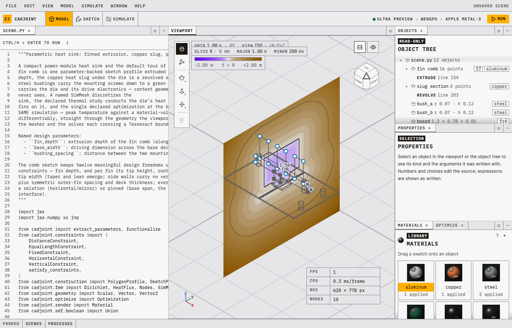](assets/screens/sdf-slice.png)

### Feature edges and wireframe

Both overlays come from one dual-contouring of the scene on the viewport's 64³
grid. **Mesh wireframe** draws its quads. **Feature edges** draws the sharp
layer: cells classified as creases, corners or exact `min`/`max` CSG seams,
linked into chains, with seam vertices Newton-projected onto the intersection
of the operands. The overlay cannot beat its grid: a bore rim is a polygon, and a
fillet smaller than a cell is drawn as the sharp edge it rounds. The
`feature_edges` [plugin kind](plugins.qmd#the-five-in-process-kinds) traces
curves exactly instead; the compile payload says which source drew them
(`lattice` or `graph`).

[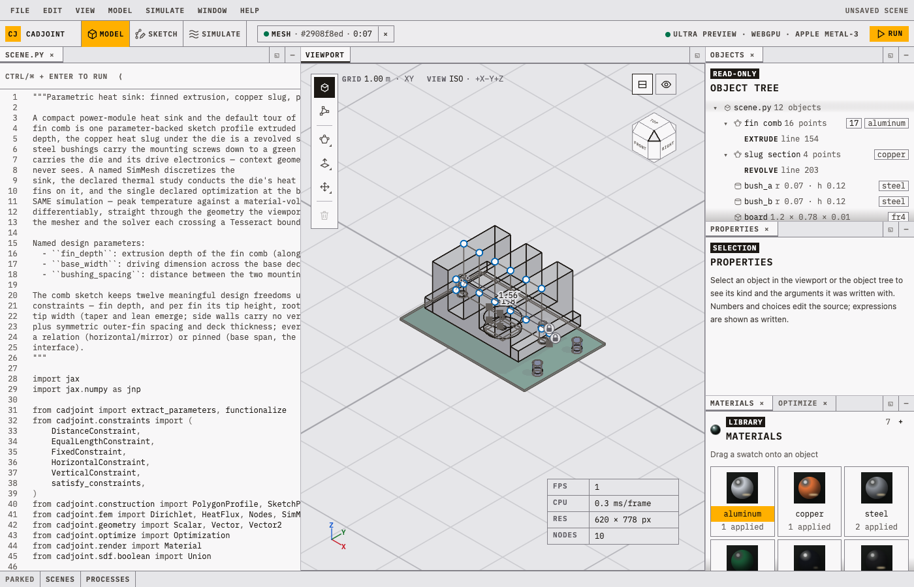](assets/screens/feature-edges.png)

### B-rep inspector

**B-rep inspector** replaces the solid with the B-rep the private tier
derived (the `brep` [plugin kind](plugins.qmd#the-five-in-process-kinds)), on
the same 64³ grid, so an extraction can be judged by eye. Each face is drawn
from the extraction's own tessellation in a categorical colour that no
neighbour shares. Edges are stroked by kind: `traced` and `sampled` are the
curves the feature-edge overlay draws, and every other boundary chain the
graph built keeps its own state (`blend`, `tangent`, `coincident`, …, or
`undrawn` for a crossing the overlay dropped). A kind the viewer has no tone
for is drawn in grey under its own name. Vertices are dots.

The card in the top-left corner gives the counts and the path. That is
`Exact · analytic`, or the dual-contouring fallback with the reason the exact
path refused. Hovering a face shows its id, surface type (plane, cylinder,
sphere, cone, blend or faceted) and owning patch. Hovering an edge shows its
faces and how far it lies off the solid. Hovering a vertex shows its position.
**Highlight off-surface** marks the edges whose points sit more than a tenth
of a cell off the scene's zero set, which is how a curve under a smooth
blend gives itself away. Each legend row is a switch that hides its kind.

The B-rep is requested lazily through `POST /api/brep` and only while the
inspector is on. Without diff-brep the switch is greyed out with the reason;
when the extraction raises, the card prints the exception and the frame it
came from, and the solid stays on screen.

### Quality and path tracing

Ultra is the default tier; the performance readout shows what it costs.

| Tier | Pixels | Bounces | Sun samples | Samples per pixel |
|---|---|---|---|---|
| Draft | 320,000 | 3 | 1 | 128 |
| High | 900,000 | 6 | 2 | 512 |
| Ultra | 4,200,000 | 8 | 4 | 1,024 |

Path tracing accumulates one jittered sample per pixel per frame in linear HDR
— GGX reflection, Fresnel glass, finite-sun next-event estimation, multi-bounce
environment light, ACES tone mapping — and restarts whenever the scene, camera
or viewport changes. See [WebGPU SDF path tracing](https://github.com/andrinr/cadjoint/blob/main/research/path-tracing.md).

## Export

**File › Export…** (`⌘E`) writes one object of the program as a file: the
format, the object — any module-level variable bound to an SDF, `scene` by
default — and the lattice resolution in cells along its longest axis.

| Format | Option |
|---|---|
| STL | Binary (default) or ASCII |
| OBJ | Merge planar faces into n-gons |
| STEP | Analytic surfaces, via the `step_export` [plugin kind](plugins.qmd#the-five-in-process-kinds); without one, the faceted writer of [`cadjoint.meshing`](meshing.qmd#export), and the report says so |
| VTK | Takes a declared study and writes its solved mesh and fields for ParaView, solving first if needed |

The export runs as a job — the job chip counts it and can stop it — and the
browser saves it under the scene's name (`heatsink-scene.stl`).

[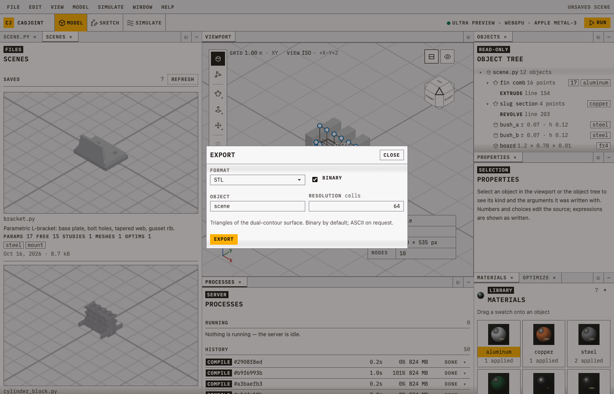](assets/screens/export-dialog.png)

## Scenes and Processes

**Scenes** (File › Open…, `⌘O`) browses the scenes directory. Each card shows
a thumbnail, the first paragraph of the file's docstring, size and date, and
counts of parameters (named and free), studies, meshes and optimizations, with
the materials it defines. Everything but the thumbnail is read with `ast`; no
file is executed to describe it. Thumbnails render one at a time from each
scene's compiled shader and are cached. **Refresh** re-reads the directory.
Opening a scene replaces the editor (an unsaved buffer asks first). **File ›
Save** (`⌘S`) and **Save As…** (`⇧⌘S`) write into the same directory, which
accepts bare `*.py` names only. **File › New** returns to the starter, and
**Download scene.py** saves the buffer through the browser.

[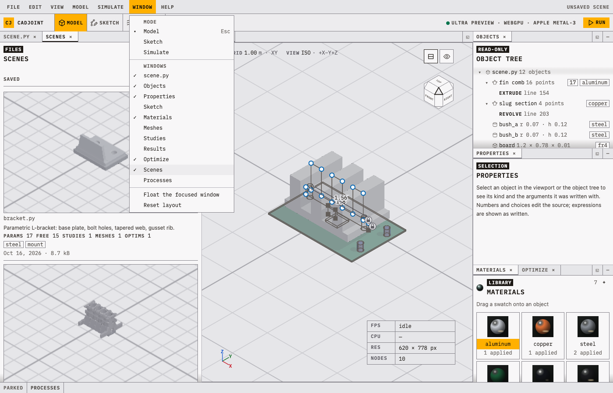](assets/screens/scenes.png)

**Processes** lists every job the server runs — compile, mesh, inspection,
solve, optimization, export, lint, and the start-up `warmup` — in three
sections. **Running** shows each job's elapsed time, CPU and memory, with a
cancel; **History** lists what finished, and clicking a solve, inspection or
optimization reopens its result in the window that draws it; **Load** shows
totals, worker CPU over the last minute, the result store's budget, and
**Clear**. Expanding a row shows its pid, CPU time, peaks and samples. The
window polls once a second while open.

[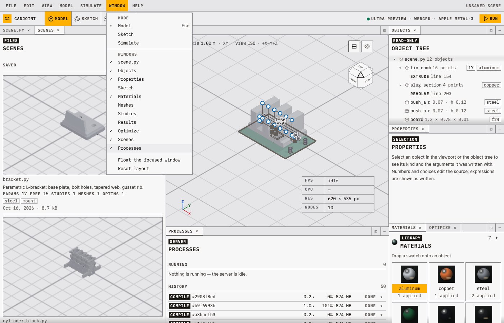](assets/screens/processes.png)

## Menus and keyboard shortcuts

Every command has a home in the menus; the rail, toolbar, windows and keys are
shortcuts to it. A command that does not apply in the current mode is shown
disabled, with the reason as its tooltip. `›` marks a submenu.

| Menu | Items |
|---|---|
| File | New, Open… `⌘O`, Save `⌘S`, Save As… `⇧⌘S`, Download scene.py, Export… `⌘E`; Program: Run `⌘↵`, Stop `⌘.` |
| Edit | Undo `⌘Z`, Redo `⇧⌘Z`, Select › (Objects `O`, Vertices `V`, None `Esc`), Delete `⌫` |
| View | Camera › (Front `1`, Right `3`, Top `7`, Opposite side `9`, Orthographic `5`), Zoom › (in `[` / out `]` one grid step), Render: Preset…, Settings…; Show › (Construction `⇧C`, Layout grid `⇧G`, Feature edges, Wireframe, Solid), Inspect › (Distance slice, Normals, Depth) |
| Model | Create › (Sketch `K`, Sketch on face, Point `P`, Box `B`, Sphere `S`, Cylinder `C`, Material), Shape › (Extrude `E`, Revolve, Loft, Move `G`, Rotate `R`, Scale `T`), Constrain › (Distance, Horizontal, Vertical, Coincident, Parallel, Perpendicular, Fix) |
| Simulate | New mesh, New study › (Thermal, Elastic, Flow), Solve `⇧⌘↵`, Optimize |
| Window | Mode: Model `Esc`, Sketch, Simulate (`M` cycles); Windows: one per window; Float the focused window, Reset layout |
| Help | Keyboard shortcuts `?`, Design language, README, Developer › Show generated WGSL |

Bare keys act only when no text field has focus; `⌘` is `Ctrl` off the Mac.
`?` opens the shortcut sheet.

## Server internals

**Compilation.** Each run evaluates the program in a fresh child process and
reads `scene`. cadjoint walks the SDF graph and writes the WGSL functions
`sdf`, `material_base` and `material_optics` directly; the browser embeds them
in the preview or path-tracing runtime and builds the pipelines. A profile's
vertices are buffer slots and a pattern is a loop, so the module stays small.
`CADJOINT_SHADER_FORM=traced` selects the JAX/StableHLO backend, tested
point for point against the direct one; a shape the direct backend has no
kernel for falls back to it and says so. Help › Developer › Show generated WGSL
shows the module. Python tracebacks and WGSL errors appear under the editor.

**Caching.** The worker uses JAX's persistent compilation cache under
`~/.cache/cadjoint/jax` (`CADJOINT_CACHE_DIR` moves it,
`CADJOINT_NO_COMPILATION_CACHE=1` disables it), and traces parameters as
arguments, so a re-dimensioned design hits the cache; on the starter scene a
warm solve takes 3.1 s against 14.3 s cold (`benchmarks/jax_compile_profile.py`).
The server warms the cache for the scene it opens. See
[program size](meshing.qmd#program-size) and the
[performance notes](https://github.com/andrinr/cadjoint/blob/main/research/performance.md).

**Source patches.** Every edit is a `/api/patch` request that rewrites a span of
the source; there are 28 operations. Each addressable thing carries a **stable
id** derived from its AST path and the name the program gave it —
`assign:comb_profile`, `call:extrude@comb_profile`, `box:block`,
`bc:sink-conduction[1]`, `face:sink:cap+` — so an edit elsewhere in the file
cannot redirect a patch; only an object with neither a variable nor a `name=`
falls back to an ordinal `#<n>`.

**The contract.** Every request and response of every route, and every
message between the server and its worker process, is a pydantic model in
`cadjoint/viewer/schema/`; `api.ROUTES` lists the routes. The server checks
each worker reply against its model before a route answers (a mismatch comes
back as `error_kind: "contract"` rather than reaching the browser), and the
frontend's types are generated from the same models into `payloads.d.ts`
(`python -m cadjoint.viewer.schema.emit`). The contract is versioned:
`GET /api/session` reports `api_version`, every response carries it in
`X-Cadjoint-Api`, and a page built for another version says so instead of
misreading the server. `/compile` and `/patch` moved to `/api/compile` and
`/api/patch`; the old paths still answer.
`tests/viewer/test_parity_roundtrip.py` checks that every operation's result
parses, is deterministic and shows exactly the requested change, and that
every `set_*` is idempotent.

**Jobs.** Every request that takes real time is registered as a job with a
`job_id` and the sha256 of the source it ran on. `GET /api/jobs` lists jobs and
live CPU/RSS totals (sampled twice a second with `psutil`, or
`resource.getrusage` without it — the `sampling` field says which);
`GET /api/jobs/<id>/result` returns a finished payload unchanged;
`POST /api/jobs/<id>/cancel` kills the worker, and the original request answers
`{"ok": false, "error": "cancelled"}`; `POST /api/jobs/clear` drops finished
jobs. The registry keeps the last 50 jobs (at most 10 lints) and 64 MB of
payloads, evicting payloads first. Windows keep only a job id and source hash,
so a result survives closing its window; an evicted one offers to run again.

**Editor intelligence.** Lint, completion and signatures are static — nothing
is imported or run — and answered in the server process: `POST /api/lint`
(ruff, ~6 ms), `POST /api/complete` (jedi, ~15 ms), `POST /api/signature`
(~2 ms). Diagnostics are red (errors), amber (likely mistakes) or blue
(style), with ruff's fixes offered as actions, and a failed compile's
traceback line is underlined until the text changes. Completions resolve
against the installed `cadjoint`. Without the
`editor` extra the endpoints return an install hint and the editor stays quiet.

**Scenes API.** `GET /api/scenes`, `POST /api/scenes/load` and
`POST /api/scenes/save` refuse path separators, traversal and hidden files
before touching the filesystem. `POST /api/export` returns the file with
`Content-Disposition` and the job id in `X-Cadjoint-Job`.

## Live example

::: {.callout-note}
WebGPU requires localhost or HTTPS and a browser/platform combination with an
available GPU adapter. The viewer reports adapter, device, context, shader, and
device-loss failures directly over the canvas. Firefox enables WebGPU by default
on Windows and Apple-silicon macOS; Linux support remains
[Nightly-only](https://developer.mozilla.org/en-US/docs/Mozilla/Firefox/Experimental_features).
:::

<link rel="stylesheet" href="assets/webgpu-viewer.css">

<div class="cadjoint-webgpu-demo" data-cadjoint-webgpu-viewer>
  <canvas data-viewer-canvas aria-label="Interactive WebGPU rendering of the cadjoint orbital example"></canvas>
  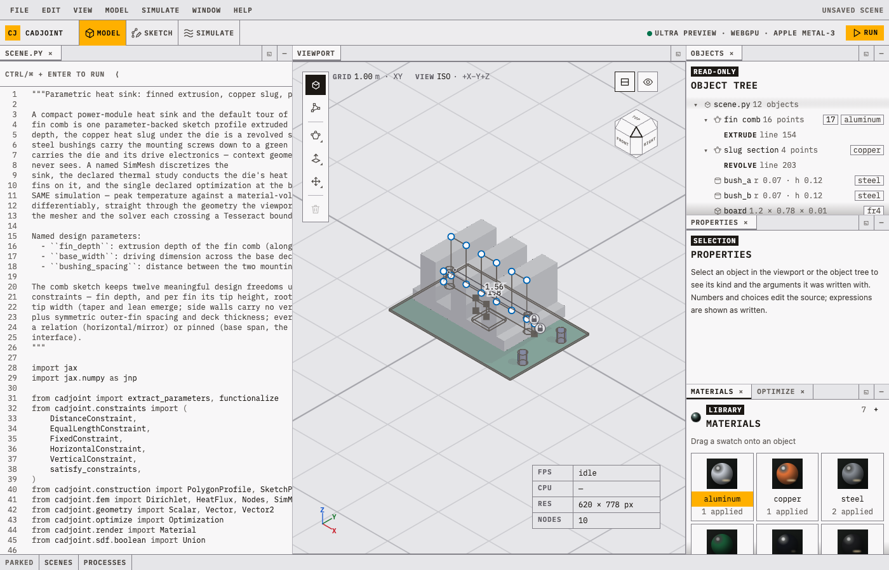
  <div class="cadjoint-webgpu-status" data-viewer-status aria-live="polite">Starting WebGPU…</div>
  <button class="cadjoint-webgpu-reset" data-viewer-reset type="button">Reset camera</button>
  <div class="cadjoint-webgpu-help">Drag to orbit · Scroll to zoom</div>
</div>

<script type="module" src="assets/webgpu-viewer.js"></script>

The canvas runs a stored shader that cadjoint generated from a Python scene.
The documentation is static, so editing and running Python stays in the local
playground.

## Jupyter widget

For a compact viewer inside a notebook, with the `viewer` extra installed:

```python
from cadjoint.sdf.primitives import Box, Sphere
from cadjoint.viewer import SDFViewer

viewer = SDFViewer(Sphere(radius=1.0), height=480)
viewer
```

Drag orbits, scroll zooms, right-drag pans, double-click resets. Recompile a
widget in place, without recreating its output cell:

```python
viewer.update_scene(Box(size=[1.0, 0.6, 0.4]))
```

[Rendering](rendering.qmd) has a complete composition and hot-reload example.

## Developing the UI

The app is a Solid + TypeScript project in `frontend/`, built into
`cadjoint/viewer/static` and committed, so installing cadjoint needs no Node
toolchain.

```bash
cd frontend
npm install
npm run dev        # Vite on :5173, proxying the API to the Python server
npm run build      # refresh cadjoint/viewer/static (commit the result)
npm test           # unit tests (vitest)
npm run e2e        # Playwright, drives the real server end to end
```

Run `uv run cadjoint-viewer` alongside `npm run dev` so the dev server has an
API to proxy to. Help › Design language opens the interface's design rules and
the feature index the menus are generated from.

## Troubleshooting

**WebGPU is unavailable.** Use a WebGPU-capable browser with hardware
acceleration enabled. The editor still compiles, and Help › Developer › Show
generated WGSL still shows the shader.

**The command is not found.** Run `python -m cadjoint.viewer.playground --open`,
or reinstall so the `cadjoint-viewer` console script is created.

**It stops at startup with `No module named 'pydantic'`.** The `viewer` extra
is missing: `pip install "cadjoint[viewer,editor]"`, or
`uv sync --extra viewer --extra editor` in a checkout.

**A scene does not compile.** The program must assign an SDF to a variable
named `scene`. The error under the editor carries the Python traceback or the
WGSL compiler message.
